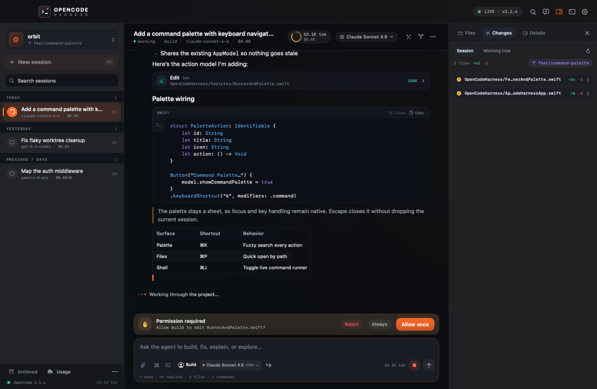
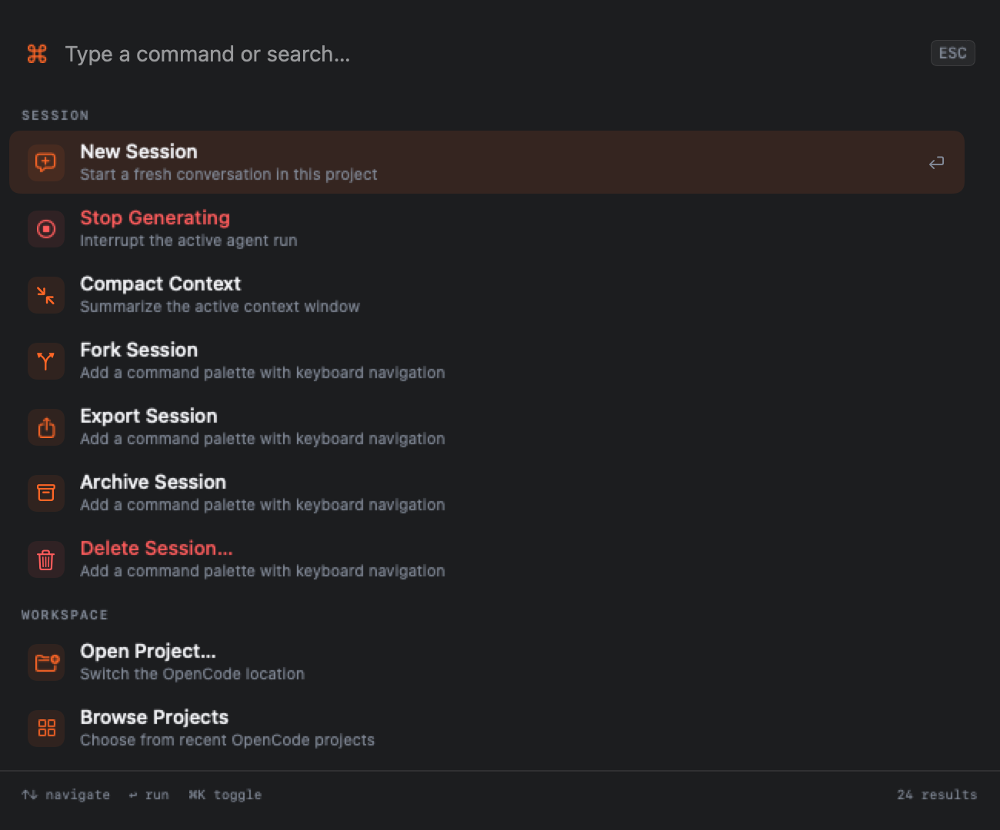
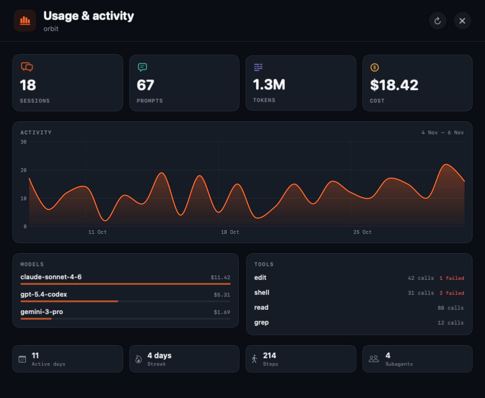

# OpenCode Harness

A native macOS desktop harness for [OpenCode](https://opencode.ai), written in Swift and SwiftUI.
It talks directly to the local OpenCode v2 HTTP API — no Electron, no embedded browser, no web UI.



## What it does

OpenCode Harness turns the OpenCode CLI/agent runtime into a native desktop workspace:

- **Streaming conversations** with live text, reasoning blocks, tool calls, shell cards, and token/cost accounting.
- **Real agent control** — send, steer, queue, interrupt, compact, fork, revert, archive, export, and import sessions.
- **Full tool loop** — approvals, dynamic forms, questions, file reads/writes, diffs, and shell execution.
- **Project-aware** — switch workspaces, browse files, quick-open paths, view working-tree and per-turn diffs, initialize Git, and manage worktrees.
- **Models & agents** — searchable provider/model catalog with variants, primary/subagent selection, context meter, and per-session switching.
- **Providers & auth** — API-key and browser OAuth integration flows backed by the running OpenCode server.
- **MCP & plugins** — inspect, connect, disconnect, add, and remove MCP servers; inspect plugins and check for updates.
- **Usage analytics** — native Swift Charts activity, token, cost, model, and tool-usage views.
- **Native macOS surface** — command palette (⌘K), quick open (⌘P), keyboard shortcuts, menu commands, dark/light themes, materials, spring animations, and a self-contained shell runner.
- **Local or remote** — automatically discovers the OpenCode background service, or connects to a remote server URL.

## Requirements

- macOS 15 or newer
- Xcode 16 or newer (built and tested with Xcode 26)
- OpenCode CLI **2.x** installed and available on `PATH` (or at `~/.opencode/bin/opencode`)
- A configured OpenCode provider/model

The app is intentionally **not sandboxed**: it needs to launch/discover the OpenCode CLI and read your project folders. No project data leaves your machine except through the providers you configure in OpenCode.

## Run

```bash
git clone <this-repo> opencode-harness
cd opencode-harness
./script/build.sh
open "dist/OpenCode Harness.app"
```

Or open `OpenCodeHarness.xcodeproj` in Xcode, choose the **OpenCodeHarness** scheme, and press **Run**.

On launch the harness:

1. Finds the `opencode` binary.
2. Reuses the OpenCode background service (`opencode service status`), starting it if needed.
3. Reads the service password from `~/.config/opencode/service.json`.
4. Connects to the v2 API and subscribes to the SSE event stream.
5. Restores the last project and session, or shows the project picker.

If the CLI is in a non-standard place, set **Settings → General → Binary path**.

## Screens

| | |
|---|---|
|  |  |
| Command palette | Usage & activity |

## Keyboard shortcuts

| Shortcut | Action |
| --- | --- |
| `⌘K` | Command palette |
| `⌘P` | Quick open file |
| `⌘N` | New session |
| `⇧⌘O` | Open project |
| `⇧⌘I` | Toggle inspector |
| `⌘J` | Toggle shell |
| `⌘.` | Stop generating |
| `⇧⌘K` | Compact context |
| `⌘R` | Refresh |
| `⇧⌘U` | Usage statistics |
| `⌘,` | Settings |
| `↩` | Send |
| `⇧↩` / `⌥↩` | Insert newline |
| `@` | Mention a file |
| `/` | Browse commands |

## Architecture

```
OpenCodeHarness/
  App/         SwiftUI app entry, window, app commands
  Core/
    AppModel.swift        Observable main-actor application state
    APIClient.swift       Typed client for the OpenCode v2 HTTP API
    OpenCodeServer.swift  Binary discovery + background service lifecycle
    EventStream.swift      Delegate-backed SSE client with auto-reconnect
    Models.swift           API + timeline domain models
    AppPreferences.swift  Persisted UI settings (Keychain for remote password)
  Design/      Theme, components, Markdown/code/diff rendering
  Features/    Chat, composer, sidebar, inspector, settings, palette, stats…
  Resources/   App icon + accent color
```

The harness keeps a single `AppModel` as the source of truth. The model:

- refreshes session/message snapshots from the API,
- applies streaming deltas from SSE immediately for a smooth typing effect,
- reconciles with persisted messages on step/turn completion,
- auto-recovers by re-resolving the service URL/password if the server restarts.

## OpenCode API coverage

| CLI area | Harness surface |
| --- | --- |
| `run`, interactive prompt | Composer, queue/steer delivery, shell mode, attachments, `@` files, `/` commands |
| Sessions | list/create/rename/archive/delete/fork/export/import, restore last session |
| `models` | searchable model + variant picker, default model, context window |
| Agents | primary/subagent picker, per-session switch |
| Permissions | inline approval banner (`once`/`always`/`reject`) |
| Forms / questions | native dynamic form sheet |
| Filesystem | lazy file tree, quick open, file preview, reveal/open externally |
| VCS | branch, status, working-tree diff, session-turn diff, Git init |
| Shell | session shell mode + live background command runner with streaming output |
| MCP | list/connect/disconnect/add/remove |
| Plugins | list, update check |
| Providers/auth | provider list, API-key + OAuth + external flows, credential list/remove |
| Config | config paths, shell selector, reload, open config file |
| Worktrees | list, create, switch |
| Stats | native usage dashboard |
| Service | auto-discovery, reconnect, remote URL mode, runtime logs |

## Notes and limits

- The shell runner uses OpenCode's server-side shell API rather than embedding a VT100 terminal. Use **Open in terminal** / Finder for a full terminal.
- OAuth flows are delegated to the provider's browser page; code-based flows can be pasted back into the connect sheet.
- Raw CLI maintenance commands (`upgrade`, `uninstall`, `api`, `debug heap-dump`) are intentionally not exposed as one-click desktop actions. Service status, logs, config, and reconnect are exposed in Settings.
- The app is ad-hoc signed for local use; set your own signing team in Xcode for distribution.

## Development helpers

- `script/build.sh` — release build into `dist/`
- `script/make_icon.swift` — regenerate the app icon source image
- `script/Snapshot/main.swift` — render deterministic screenshots of every screen without a logged-in desktop session
- `script/Integration/Main.swift` — end-to-end smoke test of boot → create session → prompt → streamed reply → delete session

## Contributing

Contributions welcome! Start with [CONTRIBUTING.md](CONTRIBUTING.md) for build
setup, code conventions, and the PR checklist. In short: no third-party
dependencies, native UI tokens from `Theme.swift`, Conventional Commits, and a
DCO sign-off (`git commit -s`) on every commit.

- 🐛 Bug reports and feature requests → [issue templates](https://github.com/YOUR_GITHUB_USERNAME/opencode-harness/issues/new/choose)
- 🔐 Security problems → **never** as public issues; see [SECURITY.md](SECURITY.md)
- 🤝 Community conduct → [CODE_OF_CONDUCT.md](CODE_OF_CONDUCT.md)

## License

The code is released under the [MIT License](LICENSE).

What that means, practically:

- **You can** use, copy, modify, merge, publish, distribute, sell, and
  sublicense the app and its source — including commercially. Build your own
  client from it, ship it in your org, fork it, whatever.
- **You cannot** hold the authors liable; the software comes "as is", without
  warranty of any kind (expressed or implied). Read the full license text.
- **The only obligation** is to keep the copyright + permission notice in
  all copies or substantial parts of the software. If you distribute a binary
  (e.g. your own build of this app), include the notice somewhere visible —
  an About panel entry or a `LICENSE` file next to the app is enough.

Note that **OpenCode itself is a separate project** with its own license; this
repository covers only the harness. The name "OpenCode Harness" references the
OpenCode project it integrates with and is not an official product of it.

Contributions are accepted under the [DCO](https://developercertificate.org)
and are licensed to everyone under the same MIT license.
